<div align="center">



<br>

[](https://github.com/alexdoescodes/csearch/actions/workflows/ci.yml)
[](https://github.com/alexdoescodes/csearch/releases)
[](pyproject.toml)
[](#requirements)
[](LICENSE)

**You remember *what* you worked on with Claude. You don't remember *where*, or which of 300 sessions it was.**
<br>
`csearch` finds it by topic, lets you pick with the arrow keys, and drops you straight back in.

[Install](#install) · [Usage](#usage) · [How it works](#how-it-works) · [FAQ](#faq)

</div>

---

<p align="center">
  
</p>

## Why

`claude --resume` shows the sessions for the directory you're in, newest first.
That works until the session you want is from two weeks ago, in another
project, and you only remember that it was *"the one about docker backups"*.

`csearch` searches **every** session on your machine by what it was about:

- 🔎 **Topic-first fuzzy search.** Matches the session title, every prompt you
  typed, and the project path. It's typo-tolerant, so `dokcer` still finds docker.
- 🏆 **Best five, ranked.** No wall of results. Just the top matches, with the
  line that matched so you can tell similar sessions apart.
- ⌨️ **Arrow-key picker.** `↑`/`↓` (or `j`/`k`), `Enter` to resume, `1`–`9` to
  jump, `Esc` to bail.
- 📂 **Resume from anywhere.** It switches to the session's own project
  directory and runs `claude --resume <id>`, even if that project has moved since.
- ⚡ **Fast.** The first run indexes everything (about 2 s for ~1,400 sessions).
  After that only changed files are re-read, and a search takes ~0.1 s.
- 🪶 **Tiny.** One Python file, one dependency ([rapidfuzz](https://github.com/rapidfuzz/RapidFuzz)), no config.

## Install

<details open>
<summary><b>uv</b> (recommended)</summary>

```sh
uv tool install git+https://github.com/alexdoescodes/csearch
```
</details>

<details>
<summary><b>pipx</b></summary>

```sh
pipx install git+https://github.com/alexdoescodes/csearch
```
</details>

<details>
<summary><b>Single file</b>, no package manager</summary>

```sh
# install rapidfuzz however your system prefers, e.g. pacman -S python-rapidfuzz,
# brew install rapidfuzz-cpp && pip install rapidfuzz, or pip install --user rapidfuzz
curl -fsSL https://raw.githubusercontent.com/alexdoescodes/csearch/main/csearch.py -o ~/.local/bin/csearch
chmod +x ~/.local/bin/csearch
```
</details>

### Requirements

- Linux or macOS. The picker uses `termios`, so Windows is only supported through WSL.
- Python 3.10+
- [Claude Code](https://docs.anthropic.com/en/docs/claude-code), with `claude` on your `PATH`

## Usage

```sh
csearch docker backup          # search, pick, resume
csearch                        # prompts for the search words
csearch -p invoice pdf         # print the matches, no picker (good for scripts)
csearch -n 10 auth             # show 10 instead of 5
csearch --reindex              # rebuild the cache from scratch
```

| Key | Action |
| --- | --- |
| `↑` / `k` | Move up |
| `↓` / `j` | Move down |
| `Enter` | Resume the selected session |
| `1`–`9` | Resume that row right away |
| `Esc` / `q` / `Ctrl-C` | Quit |

**Tips**

- Mix topic and project words: `csearch myApp login` favours sessions from
  `~/…/myApp` that talk about login.
- Name important sessions with Claude Code's `/rename`. Custom titles are
  matched and shown first.

### Environment

| Variable | Default | What it does |
| --- | --- | --- |
| `CLAUDE_CONFIG_DIR` | `~/.claude` | Where Claude Code keeps its data. Sessions are read from `projects/` inside it. |
| `XDG_CACHE_HOME` | `~/.cache` | The index lives in `claude-session-search/` inside it. |

## How it works

<picture>
  <source media="(prefers-color-scheme: dark)" srcset="docs/assets/how-it-works-dark.svg">
  
</picture>

1. **Read.** Claude Code stores each session as a JSONL transcript in
   `~/.claude/projects/<encoded-project-path>/<session-id>.jsonl`. `csearch`
   pulls out the title (`/rename` title or Claude Code's auto title), the
   prompts you typed, and the project directory. Injected context (system
   reminders, IDE selections, command output), tool results, Claude's replies
   and subagent transcripts are skipped, because they add noise, not topic.
2. **Index.** The extracted text goes into a small JSON index keyed by
   file size and modification time, so a search only re-reads sessions that
   changed since the last run.
3. **Rank.** Every query word is fuzzy-matched against each field with
   [`partial_ratio`](https://rapidfuzz.github.io/RapidFuzz/Usage/fuzz.html#partial-ratio),
   weighted by how telling the field is:

   | Field | Weight |
   | --- | --- |
   | Title | 1.00 |
   | Your prompts | 0.85 |
   | Project path | 0.80 |

   The per-word scores are averaged (70%) and blended with a whole-phrase
   match (30%). A small bonus (up to +3) favours sessions from the last 90 days.
4. **Resume.** Claude Code looks up a session by the directory it was started
   in, so `csearch` `cd`s there and `exec`s `claude --resume <id>`. If the
   project has moved, it walks the filesystem to find the directory that
   matches the session's folder name.

## FAQ

<details>
<summary><b>Does it send my sessions anywhere?</b></summary>

No. It makes no network requests. It reads your local transcripts and writes one
cache file (`~/.cache/claude-session-search/index.json`, owner-only
permissions). See [SECURITY.md](SECURITY.md).
</details>

<details>
<summary><b>Why not search Claude's replies too?</b></summary>

Replies are full of file dumps, logs and code. Those drown out the handful of
words that say what a session was *about*. Titles plus your own prompts turn
out to be a far better signal.
</details>

<details>
<summary><b>A session I expected isn't showing up.</b></summary>

Run `csearch --reindex` to rule out a stale cache. Sessions where you only
ran slash commands like `/clear` have almost nothing to match on.
Subagent transcripts aren't listed because they can't be resumed directly.
</details>

<details>
<summary><b>It broke after a Claude Code update.</b></summary>

`csearch` reads Claude Code's on-disk transcript format, which is an internal
detail, not a public API, and can change. Please
[open an issue](https://github.com/alexdoescodes/csearch/issues/new/choose) with
your `claude --version`.
</details>

## Contributing

Bug reports and PRs are welcome. See [CONTRIBUTING.md](CONTRIBUTING.md). The
README animations are generated by [`scripts/build_assets.py`](scripts/build_assets.py).

## License

[MIT](LICENSE) © Alexander Hohenhorst

<sub>csearch is an independent project. It is not affiliated with or endorsed by Anthropic.
"Claude" and "Claude Code" are trademarks of Anthropic.</sub>
